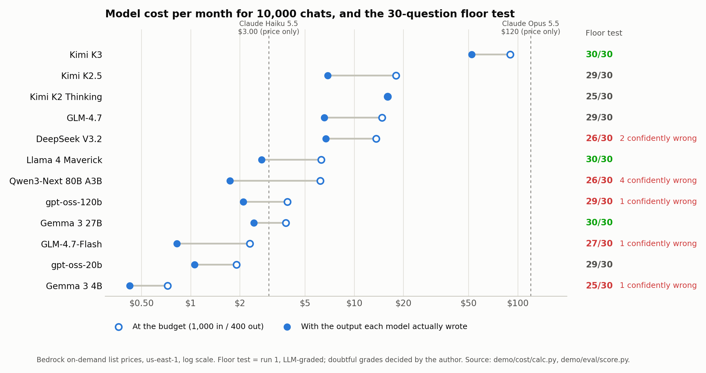
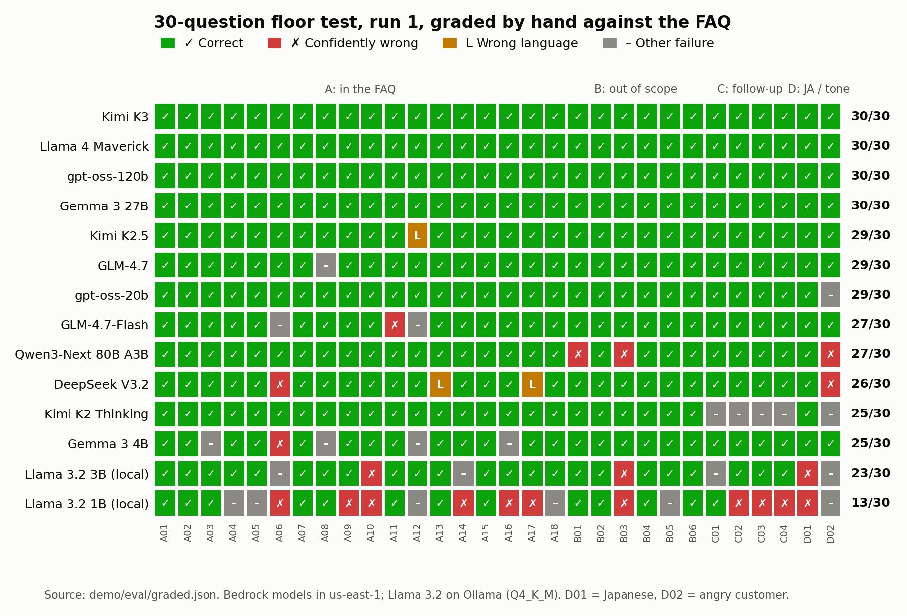

# $90, $18, $3.90… Where Does the Chatbot Bill Stop?

*Walking an AWS support bot down the open-weight model shelf at list price, and keeping score of what each dollar bought.*

---

## Introduction: the scary part was never the token price

Every team that adds a chatbot to a product has the same nightmare: a user pastes an entire wiki into the chat window at 3 a.m., the conversation history grows without bound, and the monthly bill arrives like a phone number.

[The Frugal Architect](https://thefrugalarchitect.com/), Werner Vogels' collection of laws for building cost-aware systems, is a good lens for this. The first law is *Make Cost a Non-functional Requirement*. I read the laws as drawing a line between frugal and cheap. Cheap means cutting corners and hoping nobody notices. Frugal means knowing what each design decision costs, and spending only where it buys something real.

This time I priced the bot on open-weight models. Their weights are published, so the same model is sold by several hosts at different prices, and you can move to another host, or run it yourself, without changing what the bot says. Amazon Bedrock now serves a long list of them on demand: Moonshot's Kimi, DeepSeek, Qwen, Z.ai's GLM, OpenAI's gpt-oss, Google's Gemma, and Meta's Llama. Proprietary models appear here only as price yardsticks.

I started at the most expensive open-weight model on the shelf, because I wanted to see what "good" looks like before trading it away. Then I walked down, one price step at a time, and asked at each step whether the bot still did its job. The same chatbot appears five times:

1. Stage 1: the open-weight flagship, Kimi K3 on Amazon Bedrock, behind a Lambda function.
2. Stage 2: the same architecture, walking down the open-weight shelf through eleven cheaper models.
3. Stage 3: the same architecture, with the cost levers that are pure configuration.
4. Stage 4: the rest of the AWS bill at list price, and a worst case you can name before you deploy.
5. Stage 5: one more step down, where the question stops being "which model?"

### What I ran, and what I didn't

Every price in this article is a list price, and every monthly figure is calculated from list prices. No free tier is subtracted anywhere. The floor results are measurements. The code is in the companion repository (`demo/`):

- A cost script (`demo/cost/calc.py`) that produces every dollar figure here from one price file. The Bedrock prices in that file were read from the AWS Price List API on 2026-11-19 and 2026-11-20.
- Offline tests for the Stage 1 handler (`demo/stage1/`). They use botocore's `Stubber`, which validates each request against the real Converse and DynamoDB API schemas without calling AWS.
- A 30-question floor test (`demo/eval/`). It ran three times on each of twelve open-weight models on Bedrock (one run of Llama 4 Maverick was cut short, as Stage 2 explains), and on two small Llama models locally. Every model got the same system prompt, the same FAQ, and the same request. I graded the first run of every model by reading each answer against one written rubric.
- Live checks of the Converse behaviors the code relies on: history that starts with an assistant turn, `temperature`, and `outputConfig.effort`, on five of the models.
- A minimal implementation of the last rung (`demo/stage5/`), served locally and smoke-tested.

All the Bedrock calls for this edition, including probes and one run I had to throw away, cost $0.87, computed from the logged token counts at list prices.

Some things I could not run. A Converse call to Claude Haiku 5.5 returned `AccessDeniedException: ... is not available for this account`, so Claude appears only as a price. Two of the most interesting cheap models live outside Bedrock: Kimi K2.6 on Moonshot's API and DeepSeek V4.1-Flash on DeepSeek's API. I had no API key for either provider, so they are priced, not tested. Gemma 4 has Bedrock prices, but Converse rejects its model ID ("The provided model identifier is invalid"), so it is not in the test either.

### The unit of comparison

- 10,000 chats per month.
- Each chat is budgeted at 1,000 input tokens and 400 output tokens. The input is the system prompt with the FAQ, a trimmed slice of history, and the user's question.
- List prices in US East (N. Virginia), on demand, from the AWS Price List API. Kimi K3 is quoted at its global cross-Region rate. Its in-Region rate is 10% higher.
- Measured output, next to the budget. In the test runs a question used about 530 to 630 input tokens, and most models wrote 25 to 35 output tokens on average. The models that reason before they answer wrote far more, and their reasoning is billed as output. So the tables show two monthly figures: one at the 400-token budget, and one at the output each model actually wrote.
- The formula, per chat: `input_tokens/1M × input_price + output_tokens/1M × output_price`, times 10,000.

### The floor: what "minimum viable" means

Before pricing anything, I defined the least a support chatbot must do to deserve the name:

- Answer questions from the context you give it (your FAQ, your docs), accurately and in the user's language.
- Admit ignorance and offer a ticket or a human when the answer isn't in the context, instead of improvising.
- Hold a few turns of context, so "and how do I undo that?" works.
- Stay polite, on-topic, and concise.

The 30 questions in `demo/eval/questions.json` map to this list:

- 18 answerable from the FAQ
- 6 out of scope: a student discount, HIPAA, Evernote import, a Linux release date, a Python script, the weather
- 4 follow-ups that need history
- 1 question in Japanese
- 1 angry customer

A pass means the answer is correct per the FAQ, in the user's language, and invents nothing: no policy, feature, step, URL, or number that the FAQ doesn't contain. A confidently wrong answer is a fluent answer that contradicts the FAQ or invents something. Thirty questions is a smoke test, not a benchmark, so run the harness against your own FAQ before you trust mine.

## Stage 1: Start at the top, Kimi K3 behind Lambda

The architecture is small: a static chat page, one Lambda function with a function URL, Amazon Bedrock for the model, and a DynamoDB table for the quota in Stage 4. There are no servers to patch and no GPU to feed. You pay per token, plus fractions of a cent of compute.

The most expensive open-weight model I found a Bedrock price for is Moonshot's Kimi K3. Its weights are on Hugging Face under the Kimi K3 License, an MIT-style license that asks hosting providers above $20 million in yearly revenue for a separate agreement. On Bedrock it costs $3.00 per 1M input tokens and $15.00 per 1M output tokens. Per chat: `0.001 × $3.00 + 0.0004 × $15.00 = $0.009`. Times 10,000 chats, that is $90 a month in model costs. For scale, Claude Opus 5.5 at its list price of $4/$20 would be $120.

Here is the backend, using the Bedrock Converse API from Lambda (Python). The full file and its tests are in `demo/stage1/`:

```python
import json, os, boto3

bedrock = boto3.client("bedrock-runtime")
MODEL_ID = os.environ.get("MODEL_ID", "global.moonshotai.kimi-k3")
SYSTEM_PROMPT = open("faq.md").read()        # instructions + the FAQ, ~600 tokens
MAX_MESSAGES = 7                             # 3 exchanges + the new question
MAX_CHARS_PER_MESSAGE, MAX_BODY_BYTES = 2_000, 16_000

def trim_history(history):
    if any(len(m["text"]) > MAX_CHARS_PER_MESSAGE for m in history):
        raise ValueError("message too long")
    trimmed = history[-MAX_MESSAGES:]
    while trimmed and trimmed[0]["role"] != "user":   # always open with a user turn
        trimmed = trimmed[1:]
    if not trimmed or trimmed[-1]["role"] != "user":
        raise ValueError("the last message must come from the user")
    return trimmed

def handler(event, context):
    body = event.get("body") or "{}"
    if len(body.encode()) > MAX_BODY_BYTES:
        return {"statusCode": 413, "body": "request too large"}
    try:
        messages = trim_history(json.loads(body).get("messages", []))
    except (ValueError, KeyError, TypeError) as e:
        return {"statusCode": 400, "body": str(e)}

    response = bedrock.converse(
        modelId=MODEL_ID,
        system=[{"text": SYSTEM_PROMPT}],
        messages=[{"role": m["role"], "content": [{"text": m["text"]}]} for m in messages],
        inferenceConfig={"maxTokens": 1024},
    )
    answer = "".join(b.get("text", "") for b in response["output"]["message"]["content"])
    print(json.dumps({"usage": response["usage"]}))   # the meter for this system
    return {"statusCode": 200, "headers": {"Content-Type": "application/json"},
            "body": json.dumps({"answer": answer, "usage": response["usage"]})}
```

Four details in this snippet do quiet financial or correctness work:

- **The history is trimmed so that it starts with a user turn.** My first draft used `history[-6:]`. The client always sends an odd number of messages, because the list ends with the user's new question, so from the fourth turn on that slice starts with an assistant message. Kimi K3, Kimi K2.5, and both gpt-oss models answered such a request. Gemma 3 27B rejected it with a `ValidationException`: "Conversation roles must alternate user/assistant/user/assistant/...". A chatbot that breaks on turn four for some models and not others is the worst kind of bug, so the handler never sends one, and a unit test reproduces the bad slice.
- **Size is checked before any token is spent.** The 3 a.m. wiki paste gets a 413 and costs nothing.
- **There is no `temperature`.** Kimi K3 rejects the whole request with `This model doesn't support the temperature field`. The other four models I checked accepted `temperature: 0.7`. A FAQ bot gains nothing from it either way.
- **There is no `outputConfig.effort`, and `maxTokens` is 1,024, not 400.** Kimi K3 accepted `effort: low`. Kimi K2.5, both gpt-oss models, and Gemma 3 27B rejected it with `This model doesn't support the effort field`. The handler has an `EFFORT` setting, off by default. The cap is generous because reasoning tokens count toward `maxTokens`. Even so, Kimi K2 Thinking hit 1,024 on three of its 90 test answers, and two of those came back empty.

Kimi K3 reasons before it answers, and its reasoning is billed as output. Across the 90 test answers it wrote 148 output tokens on average, and at most 403. That is well under the 400-token budget on average, so the measured bill comes to $52.23 a month instead of $90. Log `usage.outputTokens` from day one, because it is the only number that tells you which of those two you are paying.

The execution role needs `bedrock:InvokeModel` on the inference profile and the models it routes to. Raise the Lambda timeout from its 3-second default to 30 seconds. Kimi K3's slowest test answer took 4.2 seconds, and DeepSeek V3.2's took 14.8.

Kimi K3 passed 30 of 30. It apologized to the angry customer before it pointed them to Trash, and it declined all six out-of-scope questions without inventing anything. FAQ traffic rarely needs that much model, though. On "How do I reset my password?" it billed 124 output tokens for a three-sentence answer, and most of them were reasoning.

## Stage 2: Walk down the open-weight shelf

Same code, same architecture. Only `MODEL_ID` changes. Here are the twelve models I tested, most expensive first, measured with the same 30 questions. Bedrock serves more open-weight models than these (GLM-5, MiniMax M2.5, NVIDIA Nemotron, and Mistral's, among others); I picked one or two per family. The floor test column is the hand-graded first run:

<!-- table:shelf -->
| Model | $/month at the budget (1,000 in / 400 out) | $/month with measured output | Floor test | Confidently wrong | What went wrong |
|---|---|---|---|---|---|
| Kimi K3 | $90.00 | $52.23 | 30/30 | 0 | nothing |
| Kimi K2.5 | $18.00 | $6.87 | 29/30 | 0 | one answer in French |
| Kimi K2 Thinking | $16.00 | $16.03 | 25/30 | 0 | reasoning text shown on all four follow-ups; one empty answer at the 1,024-token cap |
| GLM-4.7 | $14.80 | $6.54 | 29/30 | 0 | said it didn't know the Android requirement |
| DeepSeek V3.2 | $13.60 | $6.71 | 26/30 | 2 | "Yes, you can get a full refund" after three weeks; sent a user to Export to recover notes; two answers in Spanish and French |
| Llama 4 Maverick | $6.28 | $2.71 | 30/30 | 0 | nothing (but see below) |
| Qwen3-Next 80B A3B | $6.20 | $1.74 | 27/30 | 3 | invented a no-student-discount policy and an Evernote workaround; promised help "immediately" |
| gpt-oss-120b | $3.90 | $2.09 | 30/30 | 0 | nothing |
| Gemma 3 27B | $3.82 | $2.43 | 30/30 | 0 | nothing |
| GLM-4.7-Flash | $2.30 | $0.82 | 27/30 | 1 | told a user their note from yesterday was gone; two false refusals |
| gpt-oss-20b | $1.90 | $1.06 | 29/30 | 0 | escalated the angry customer without mentioning Trash |
| Gemma 3 4B | $0.72 | $0.42 | 25/30 | 1 | "Yes" to a refund after three weeks; four false refusals |
<!-- /table -->





I expected price to predict the score, and it didn't. The two most expensive Kimi models scored 30 and 29. Below them, the score moved independently of the price. DeepSeek V3.2 at $13.60 failed four questions, and gpt-oss-120b and Gemma 3 27B, both under $4, failed none.

### The Kimi K2 line: Kimi K2.5 ($18) and Kimi K2 Thinking ($16)

Kimi K2.5 costs $0.60/$3.00 per 1M tokens. It writes short answers, 29 output tokens on average, so its measured bill is $6.87. It passed 29 of 30. The one failure was an English question about two-factor authentication answered in French; the content was right. That happened once in three runs.

Kimi K2 Thinking costs $0.60/$2.50, and it thinks out loud. It wrote 401 output tokens per answer on average, so the 400-token budget was about right for it, and 63% of its measured bill is output. Its content was fine. Its delivery failed in two ways:

- On the four follow-up questions, the ones that carry history, the reply text started with `<think>` and a paragraph of the model's reasoning. On single-turn questions, Bedrock returned the reasoning in a separate `reasoningContent` block, which the handler drops. With history, it came back inside the text block, so a user would see it. This happened on all four follow-ups in all three runs.
- It hit the 1,024-token cap three times in 90 answers. Twice it returned nothing at all: once on the angry customer, once on the yearly-discount question. The third time, the user would have seen a cut-off monologue.

If you buy the Kimi K2 line outside Bedrock, check availability first. Moonshot's pricing page now says: "starting October 31, 2026, K2 series models will no longer be available to newly registered users; existing users are not affected. We plan to retire all K2 series models by the end of December 2026." On Bedrock, both models still report `ACTIVE`.

### DeepSeek V3.2 ($13.60) and GLM-4.7 ($14.80)

DeepSeek V3.2 is where my expectations broke. It answered a customer who bought three weeks ago with "Yes, you can get a full refund", then quoted the 14-day rule. It told the angry customer to go to Settings > Export to get lost notes back. And it switched language on English questions: Spanish and French in the graded run, then German, French, Italian, and Portuguese in the other two. That was two, three, and three answers in the three runs.

GLM-4.7 passed 29 of 30. Its one failure was a false refusal: it said it had no information about Android 11, although the FAQ says Android 12 or later.

### Qwen3-Next ($6.20) and Llama 4 Maverick ($6.28)

Qwen3-Next 80B A3B failed in the most dangerous way. It told a customer "We do not currently offer student discounts", a policy the FAQ never states. It told another "We don't support importing from Evernote" and then suggested a manual workaround. And it promised the angry customer help "immediately", against the FAQ's "within one business day". All three were fluent and confident, so a reader has no reason to doubt them.

Llama 4 Maverick passed 30 of 30 in its graded run. Then, during the third run, Bedrock started rejecting it: `This Model is marked by provider as Legacy and you have not been actively using the model in the last 30 days`. `get-foundation-model` reports it as `LEGACY` since 2026-09-30, with an end of life on 2027-03-30. A model that passes your test can still be retired by its host, so check `modelLifecycle` before you pick one.

### Under $4: gpt-oss-120b, Gemma 3 27B, GLM-4.7-Flash, gpt-oss-20b, Gemma 3 4B

This is the part of the shelf I would deploy from.

**gpt-oss-120b ($3.90)** passed 30 of 30. It also reasons, at 99 output tokens per answer on average, which makes its measured bill $2.09.

**Gemma 3 27B ($3.82)** passed 30 of 30, with short answers and a measured bill of $2.43. It is the model that rejected an assistant-first history, so it needs the trimming rule from Stage 1.

**GLM-4.7-Flash ($2.30)** passed 27 of 30. The failure I would worry about: a user who deleted a note yesterday was told, "Since 30 days have passed, you will not see it there anymore."

**gpt-oss-20b ($1.90)** passed 29 of 30. Its one failure was the angry customer, whom it offered a ticket without mentioning Trash. Outside the test, in a behavior check, it answered "How much is Plus?" with "$4 per month (or $48 if you choose annual billing, which saves 20%)". A year at 20% off is $38.40. One question in the 30 asks about the yearly discount, and it got that one right.

**Gemma 3 4B ($0.72)** passed 25 of 30. It said "Yes" to the three-week refund and gave four false refusals, including "I don't know" for a Team price it could have multiplied.

For comparison, here is what the proprietary models on Bedrock cost at the same budget. I did not test them:

<!-- table:yardsticks -->
| Proprietary model (price only, not measured) | $ per 1M tokens in / out | $/month at the budget |
|---|---|---|
| Claude Opus 5.5 | $4.00 / $20.00 | $120.00 |
| Claude Sonnet 5.5 | $2.00 / $10.00 | $60.00 |
| Claude Haiku 5.5 | $0.10 / $0.50 | $3.00 |
| Amazon Nova Micro | $0.035 / $0.14 | $0.91 |
<!-- /table -->

At the budget, Gemma 3 27B and gpt-oss-120b cost a little more than Claude Haiku 5.5, and only Gemma 3 4B costs less than Nova Micro. I couldn't measure the proprietary models' real output, so the measured column has no counterpart for them.

The ratios hold at any scale, but the absolute numbers decide whether the rest of this article matters to you:

<!-- table:scale -->
| Chats per month | Kimi K3 | Kimi K2.5 | gpt-oss-120b | gpt-oss-20b | Gemma 3 4B |
|---|---|---|---|---|---|
| 10,000 | $90.00 | $18.00 | $3.90 | $1.90 | $0.72 |
| 100,000 | $900.00 | $180.00 | $39.00 | $19.00 | $7.20 |
| 1,000,000 | $9,000 | $1,800 | $390.00 | $190.00 | $72.00 |
<!-- /table -->

### The same weights, at other prices

Open weights mean the price depends on the host. Two models I could not test show how much it varies:

<!-- table:external -->
| Model, where | $ per 1M tokens in / out | $/month at the budget | What you need |
|---|---|---|---|
| Kimi K2.6 (Moonshot API) | $0.95 / $4.00 | $25.50 | Moonshot (platform.kimi.ai) API key |
| DeepSeek V4.1-Flash, DeepSeek API, peak | $0.30 / $1.20 | $7.80 | DeepSeek API key |
| DeepSeek V4.1-Flash, DeepSeek API, off-peak | $0.15 / $0.60 | $3.90 | DeepSeek API key |
<!-- /table -->

OpenRouter lists Kimi K2.6 from more than ten providers, from $0.39/$1.80 to $1.125/$5.25 per 1M tokens, and most of the cheap endpoints serve quantized weights. A router's headline price is one provider's endpoint, not a list price, so I left those out of the calculations.

## Stage 3: Levers that cost nothing to pull

Before changing any architecture, pull the levers that are pure configuration. They multiply whatever rung you're standing on, so they matter most near the top.

### Lever 1: Count the output tokens you actually get

The 400-token budget hides the biggest difference between these models. Most of them wrote 25 to 35 tokens per answer. The reasoning models wrote more: gpt-oss-120b about 99, gpt-oss-20b about 119, Kimi K3 about 148, and Kimi K2 Thinking about 401. Output is the expensive side of every price on this shelf, so the reasoning share decides the bill. Output is 43% of Kimi K3's measured bill and 63% of Kimi K2 Thinking's. Ask for concision in the system prompt ("3 sentences or fewer"), keep `maxTokens` as a safety net rather than the main control, and turn reasoning down where the model allows it. Of the models I checked, only Kimi K3 accepted `effort`.

### Lever 2: Stop paying full price for the prompt you send every time

Your system prompt and FAQ are identical on every request. Of the twelve models, Kimi K3 is the only one with a cache-read rate in the Bedrock price list, $0.30 per 1M tokens against $3.00 for fresh input. It also turned out to cache without being asked.

I found that by mistake. My harness priced every call as `inputTokens × input price`, and the first Kimi K3 runs reported 25 input tokens for a 600-token prompt. The rest was in `cacheReadInputTokens`, which I wasn't logging. I threw those runs away, added the cache fields, and ran Kimi K3 again through the `global` profile. In all 90 calls, about 614 tokens came from the cache, and no cache write was reported. The calls were seconds apart, so that is the best case. At 10,000 chats a month the calls are minutes apart, and I don't know how long Bedrock keeps an automatic cache entry. With 600 of the 1,000 budgeted input tokens cached on every chat, Kimi K3 drops from $90 to $73.80 a month. With no hits it stays at $90. Read `usage.cacheReadInputTokens` in your own logs to see where you land.

The trade-off is design discipline: a cached prefix has to be byte-for-byte static, so per-user data goes after the FAQ, never inside it.

### Lever 3: Trim the history, summarize the rest

A chat that replays a 40-message history on every turn can multiply its input tokens fivefold by the end of a long session. Under the budget, that takes Kimi K2.5 from $18 to $42 for the same answers, and Kimi K3 from $90 to $210. Keep the last few exchanges verbatim, replace everything older with a short running summary, and input cost per chat stays flat no matter how long the conversation runs.

## Stage 4: The rest of the bill, and the worst case

Now for the supporting cast, at list price. A function URL has no per-request charge of its own. Per chat, the bot makes one Lambda invocation at 256 MB that lasts as long as the model call, one DynamoDB write for the quota counter, and four CloudFront requests (page, script, FAQ, API call). At 10,000 chats, with Kimi K3's measured 2.0-second average:

- Lambda: $0.0873 ($0.0000166667 per GB-second, $0.20 per million requests)
- DynamoDB, on demand: $0.0063 ($0.625 per million write units)
- CloudFront: $0.123 (HTTPS requests and about 0.1 MB of static transfer per visit)

That is $0.22 a month. Next to Kimi K3's $90 it disappears. Next to Gemma 3 4B's $0.72 it is about a quarter of the bill, so at the bottom of the shelf the infrastructure starts to show. I left the free tiers out, which removes the temptation to design around them.

A function URL with auth type `NONE` is a public endpoint, so put CloudFront in front of it with origin access control. If the chat page is served from another origin, configure CORS on the function URL. With origin access control, POST requests must carry an `x-amz-content-sha256` header with the body's SHA-256 hash, which the page computes before sending. It hides the raw endpoint, but it doesn't stop anyone who opens your chat page from sending as many messages as they like. On a public chatbot, every visitor is a legitimate client.

### Put a ceiling on the worst case

My first draft capped the Lambda function at 2 concurrent executions and called that a ceiling. Two slots busy around the clock for 30 days at 256 MB cost $21.95 in Lambda charges. That figure is correct and almost irrelevant, because it caps the compute, not the tokens. Two slots that each answer one chat every 3 seconds make 1.73 million calls a month:

<!-- table:worst -->
| Concurrency 2, one call every 3 s per slot, all month | gpt-oss-20b | Kimi K2.5 | Kimi K3 |
|---|---|---|---|
| Average chats (1,000 in / 400 out) | $328.32 | $3,110 | $15,552 |
| Chats at the handler's caps (~4,700 in / 1,024 out) | $1,099 | $10,181 | $50,907 |
| With a 500-chat daily quota, average chats | $2.85 | $27.00 | $135.00 |
| With a 500-chat daily quota, every chat at the caps | $9.54 | $88.38 | $441.90 |
<!-- /table -->

An abuser won't send average chats. They will send the largest body you accept, and on a reasoning model the output will run to the cap. Concurrency limits Lambda, not Bedrock spend, so the brake has to count chats. A daily quota in DynamoDB does it in one conditional write (the full function, with a test that it returns 429 at the limit, is in `demo/stage1/handler.py`):

```python
ddb.update_item(
    TableName=TABLE,
    Key={"pk": {"S": f"quota#{today}"}},
    UpdateExpression="ADD n :one",
    ConditionExpression="attribute_not_exists(n) OR n < :max",
    ExpressionAttributeValues={":one": {"N": "1"}, ":max": {"N": "500"}},
)   # ConditionalCheckFailedException -> return 429 "try again tomorrow"
```

With 500 chats a day, the worst month on Kimi K3 is $441.90, on Kimi K2.5 $88.38, and on gpt-oss-20b $9.54. Rejected calls still run Lambda and still attempt the write, which adds about $1.79 a month under the same abuse. That is a number you can state before you deploy, and on Kimi K3 it is a reason to lower the quota or the caps. Then add an AWS Budgets alert at an amount that would make you raise an eyebrow. Budgets only raises an alarm: billing data can arrive hours late, and an alert stops nothing by itself.

What you give up: on a busy day, user number 501 gets "try again tomorrow." Whether 500 is the right number is a business decision, not a technical one.

The model still costs money on every chat, and there is one rung left.

## Stage 5: The last rung

If per-token pricing is the problem, remove the token meter. Modern browsers can run small language models on the visitor's own GPU through WebGPU. [WebLLM](https://github.com/mlc-ai/web-llm) (`@mlc-ai/web-llm`) packages this up. It downloads a quantized model into the browser, caches it, and exposes an OpenAI-style `chat.completions` API, entirely client-side. Here the visitor runs the weights.

To keep this the same chatbot, the page loads the same `faq.md` system prompt and uses the same trimming rule as the Lambda version. It also checks the GPU before it commits to a 700 MB download. The full page is in `demo/stage5/`:

```js
import { CreateMLCEngine } from "https://esm.run/@mlc-ai/web-llm@0.2.89";

const system = await (await fetch("./faq.md")).text();   // same prompt as the server

async function startLocal() {
  const adapter = await navigator.gpu?.requestAdapter();
  if (!adapter) throw new Error("no WebGPU");
  // The default q4f16 builds need the shader-f16 feature; pick a q4f32 build otherwise.
  const model = adapter.features.has("shader-f16")
    ? "Llama-3.2-1B-Instruct-q4f16_1-MLC" : "Llama-3.2-1B-Instruct-q4f32_1-MLC";
  const engine = await CreateMLCEngine(model, {
    initProgressCallback: (p) => { status.textContent = p.text; },
  });
  return async (messages, onToken) => {
    const chunks = await engine.chat.completions.create({
      messages: [{ role: "system", content: system }, ...trim(messages)],
      stream: true, max_tokens: 400,
    });
    let out = "";
    for await (const c of chunks) { out += c.choices[0]?.delta?.content ?? ""; onToken(out); }
    return out;
  };
}
// Load on intent (first click on "Start chat"), not on page load.
// If startLocal() fails, fall back to the Stage 4 function URL.
```

That's the whole chatbot. There is no API key, no backend, and no per-token anything. From WebLLM 0.2.89's model list and the Hugging Face file listings:

| Model | Download | GPU memory |
|---|---|---|
| Llama 3.2 1B (q4f16) | 705 MB | 879 MB |
| Llama 3.2 3B (q4f16) | 1.8 GB | 2.3 GB |
| Qwen3 0.6B (q4f16) | 352 MB | 1.4 GB |

Qwen3 0.6B is smaller to download than Llama 1B but needs more GPU memory. All of these run with a 4K-token context window.

### The floor test on the last rung

I ran the 30 questions on Llama 3.2 1B and 3B three times each, with the same system prompt and FAQ, 4-bit quantization, and Llama's default sampling. I ran them locally with Ollama as a stand-in for the in-browser runtime. The quantization formats differ, so treat the numbers as indicative. The grades use the same rubric as every Bedrock model above. For comparison, the table also shows Gemma 3 4B, the smallest model I tested on Bedrock:

<!-- table:browser -->
| Model | Floor test | Confidently wrong | Other failures (false refusals, off-topic answers, no answer) |
|---|---|---|---|
| Gemma 3 4B (Bedrock) | 25/30 | 1 | 4 |
| Llama 3.2 3B (local) | 23/30 | 3 | 4 |
| Llama 3.2 1B (local) | 13/30 | 11 | 6 |
<!-- /table -->

For a support bot, the confidently wrong column matters most. A wrong answer delivered fluently is worse than "I don't know." Some of the 1B model's answers:

- It told a customer they had "already used your 30-day money-back guarantee." The FAQ says 14 days.
- It said there was no discount for paying yearly. The FAQ says annual billing saves 20%.
- It invented an Evernote import feature, with directions to "the import settings."
- It said the web app works offline. The FAQ says it needs a connection.

The 1B model does not hold the floor. It fails the floor item small models lose first: knowing what it doesn't know. The 3B model gets much closer, with three confidently wrong answers, one of them a mistranslation in Japanese, and it costs 2.6 times the download. Gemma 3 4B, slightly larger again, made one confidently wrong answer and four false refusals. At this size, a model mostly fails by refusing too much or by inventing, and the 1B model invents.

An automatic keyword grader, by the way, scored the 1B model at 19 to 22 out of 30 across three runs. It passed answers that put the right keyword next to an invented claim. Read your outputs.

### Running it on my machine

I loaded the page in headless Chrome on a Linux PC with an Intel integrated GPU (the adapter reports "gen-7"). That machine is a Mac running Linux, its GPU driver is unstable, and Chrome's hardware acceleration is turned off on it for that reason. WebGPU had to be forced on with `--enable-unsafe-webgpu` and Vulkan flags, which is not a normal user's setup. The page loaded and found an adapter. The default 1B build then failed to compile, because this GPU lacks the `shader-f16` feature that the q4f16 build needs. With the feature check above, the page picked the q4f32 build instead. The first load took 93 seconds, and a repeat load from the browser cache took 4 seconds. On an otherwise idle machine, it produced no answer within nine minutes.

The compile failure and the missing answer are this machine's problem, not a limit of WebLLM. With hardware acceleration off, the browser was not really using the GPU. Most readers will run Chrome, Edge, or Safari with GPU acceleration on, which is the default and the setup WebLLM targets. I couldn't measure that setup here, so I have no speed numbers for it, good or bad. What the test does show is the shape of the failure on a machine like mine: "WebGPU is available" is not the same as "the model answers." Visitors with machines like that exist, so the fallback needs a timeout, not only a feature check. I did not test a machine with GPU acceleration on, Safari, Firefox, or a phone.

### What's left on the bill

What remains on your AWS bill is the delivery of a static site: an HTML file, a script, and the FAQ.

```bash
aws s3 sync ./dist s3://your-chatbot-bucket --delete
# CloudFront in front of the bucket (origin access control), index.html as
# the default root object, long cache TTLs on hashed assets.
```

At 10,000 visits a month and list price, that is three HTTPS requests and about 0.1 MB per visit: $0.11 a month in CloudFront charges, with S3 storage for a few files rounding to zero. There is no model charge at all.

That number depends on WebLLM's defaults. It fetches the model weights from Hugging Face and the compiled GPU code from GitHub by default, so the one heavy asset never crosses your CloudFront bill. By the definition at the top of this article, that is close to cheap: someone else is paying for the transfer, and it depends on a service you don't control. If you host the weights yourself, the delivery bill follows the number of new visitors, not chats. At $0.085 per GB:

- 2,000 first-time visitors × 705 MB for the 1B model is about 1.4 TB: $119.85 a month.
- 10,000 first-time visitors is about 7 TB: $599.25.
- For the 3B model, the one that comes closer to the floor, those become $306 and $1,491.20.

At 10,000 new visitors a month, self-hosted 1B weights cost more than Kimi K3 serving every chat.

## The limits

Stage 5 also costs things that aren't dollars:

- **The first visit is heavy.** It is 705 MB for the 1B model, and 1.8 GB for the 3B model that came closer to the floor. It's cached afterwards, but a drive-by visitor may never finish loading. Load on intent, show progress, and prefer small models.
- **Browser support is broad, not universal.** WebGPU ships in Chrome and Edge, in Safari 26, and in Firefox on Windows. Older devices, many phones, GPUs without `shader-f16`, and browsers with hardware acceleration turned off will fail or crawl. My own test machine was in that last group. The best escape hatch is a hybrid: try the local model, and if WebGPU is missing or too slow, fall back to the Stage 4 endpoint, so the metered path serves only the visitors the free path can't.
- **Small models are confidently wrong.** For support triage with a human behind it, a 3B model may be acceptable. For refunds, billing, medical, legal, or financial answers, a 1B model is not.
- **You lose the server-side view.** You get no central logs of what users asked (unless you add analytics, carefully and with consent), no instant model upgrades, and no server-side guardrails. Anyone who opens DevTools can read your system prompt.
- **The user's battery is now your compute budget.** Inference is free to you because the visitor's GPU does the work. On a plugged-in laptop that's a fine trade. On a phone at 12% battery, be polite: small models, short answers, and no warm GPU when the tab is idle.

## Conclusion: the order is the lesson

This is the order I would follow again:

1. Start at the top (Stage 1). Learn what "good" looks like for your traffic, and log `usage` from the first request, including the cache fields.
2. Walk down one price step at a time (Stage 2), with a fixed question set. Stop at the first model where the floor cracks for your questions, then step back up one. In my test the price and the score did not move together: two models under $4 a month passed 30 of 30, and a $13.60 model told a customer they could get a refund they couldn't. Check the model's lifecycle status, and the provider's availability notices, before you commit.
3. Pull the free levers, and price the worst case (Stages 3 and 4). Count real output tokens, cache what is static, trim what grows, and put a quota in front of the token meter.

Most products should stop at Stage 2 or 3. On this FAQ, $2 to $4 a month bought a model that answered all 30 questions correctly, with logs and the option to switch hosts. Stage 5 is for cases where something other than money is the constraint: no API key in the client, data that must not leave the device, offline use. Even then, choose the model by the floor, not by the download size.

Your homework, in the spirit of The Frugal Architect: take the formula from the introduction, plug in your chat count and your token counts, and run 30 of your own questions down the shelf.
