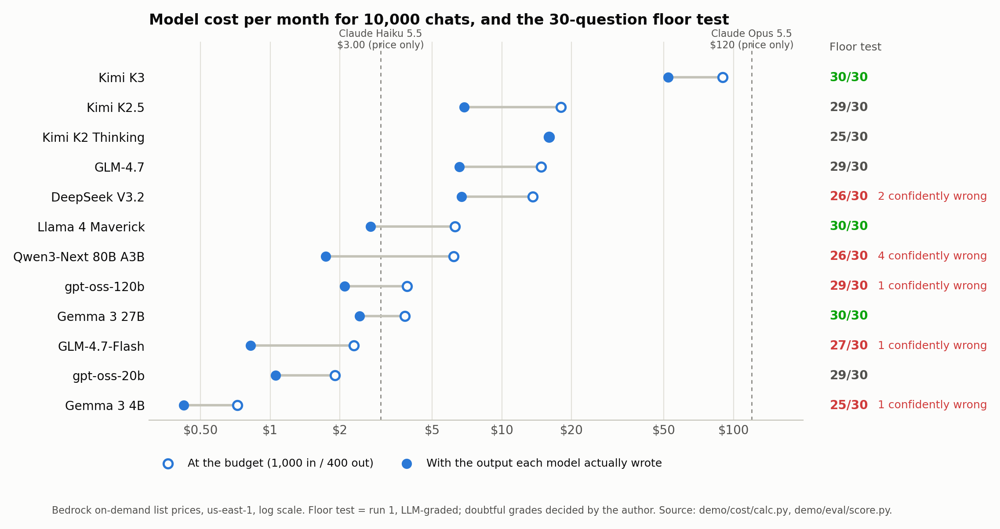
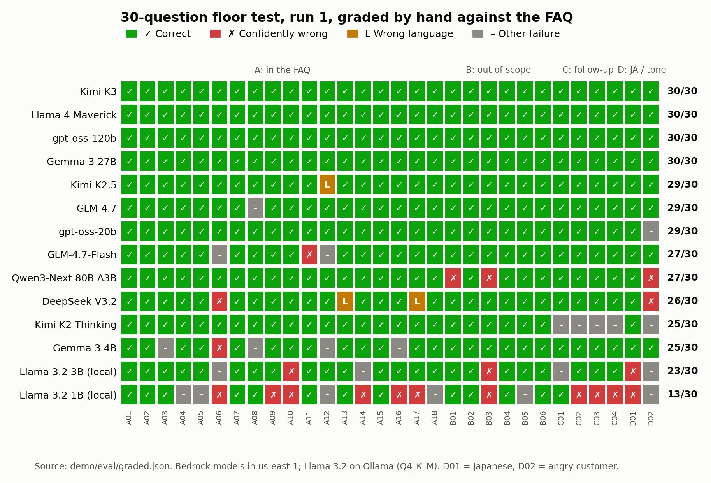

# $90, $18, $3.90… Where Does the Chatbot Bill Stop?

*Walking an AWS support bot down the open-weight model shelf at list price, and keeping score of what each dollar bought.*

---

## Introduction: the scary part was never the token price

Every team that adds a chatbot has the same nightmare: a user pastes an entire wiki into the chat window at 3 a.m., the conversation history grows without bound, and the monthly bill arrives like a phone number.

[The Frugal Architect](https://thefrugalarchitect.com/), Werner Vogels' laws for cost-aware systems, is a good lens for this. The first law is *Make Cost a Non-functional Requirement*. I read the laws as drawing a line between frugal and cheap. Cheap means cutting corners and hoping nobody notices. Frugal means knowing what each design decision costs, and spending only where it buys something real.

This time I priced the bot on open-weight models. Their weights are published, so several hosts sell the same model at different prices, and you can switch hosts, or run it yourself, without changing what the bot says. Amazon Bedrock serves many of them on demand: Moonshot's Kimi, DeepSeek, Qwen, Z.ai's GLM, OpenAI's gpt-oss, Google's Gemma, and Meta's Llama. Proprietary models are only yardsticks.

I started at the most expensive open-weight model, to see what "good" looks like, then walked down one price step at a time, asking whether the bot still did its job:

1. Stage 1: the open-weight flagship, Kimi K3 on Amazon Bedrock, behind a Lambda function.
2. Stage 2: the same architecture, walking down the open-weight shelf through eleven cheaper models.
3. Stage 3: the same architecture, with the cost levers that are pure configuration.
4. Stage 4: one more step down, where the question stops being "which model?"

Then I add up what the token price leaves out.

### How the bill is calculated

Every dollar figure in this article comes from the same price model:

- **List price, no free tier.** Bedrock prices are US East (N. Virginia), on demand, from the AWS Price List API, read on 2026-11-19 and 2026-11-20. Kimi K3 is quoted at its global cross-Region rate. Its in-Region rate is 10% higher. Lambda, DynamoDB, and CloudFront are at list price too, and no free tier is subtracted anywhere.
- **Per-token pricing.** Per chat: `input_tokens/1M × input_price + output_tokens/1M × output_price`, times the number of chats. Reasoning tokens are billed as output.
- **The workload.** 10,000 chats per month, each budgeted at 1,000 input tokens and 400 output tokens: the system prompt with the FAQ, a trimmed slice of history, and the user's question.
- **Measured output, next to the budget.** In the test runs a question used about 530 to 630 input tokens, and most models wrote 25 to 35 output tokens on average; the reasoning models wrote far more. So the tables show two monthly figures: at the 400-token budget, and at measured output.

The floor scores are measured: each model answered the same 30 questions three times (Llama 4 Maverick's third run was cut short, as Stage 2 explains), an LLM graded the first run against one rubric, and where a grade looked doubtful, I made the call myself. The cost script that recomputes every figure, the eval, and the code are in the [companion repository](https://github.com/dairappa/frugal-chatbot) (`demo/`).

### The floor: what "minimum viable" means

The bot answers for Example Notes, a made-up note-taking app. Its FAQ (`demo/faq.md`, about 600 tokens with the instructions) has twelve entries. The ones that come up below: the password reset email's link expires after 30 minutes; refunds are in full within 14 days; Plus is $4 a month, and annual billing saves 20%; Settings > Export emails all notes as a ZIP; and deleted notes stay in Trash for 30 days, where they can be restored.

First, the least a support chatbot must do to deserve the name:

- Answer questions from the context you give it (your FAQ, your docs), accurately and in the user's language.
- Admit ignorance and offer a ticket or a human when the answer isn't in the context, instead of improvising.
- Hold a few turns of context, so "and how do I undo that?" works.
- Stay polite, on-topic, and concise.

The 30 questions in `demo/eval/questions.json` map to this list:

- 18 answerable from the FAQ
- 6 out of scope: a student discount, HIPAA, Evernote import, a Linux release date, a Python script, the weather
- 4 follow-ups that need history
- 1 question in Japanese
- 1 angry customer, whose lost notes are in Trash

A pass means the answer is correct per the FAQ, in the user's language, and invents no policy, feature, step, URL, or number. A confidently wrong answer is a fluent one that contradicts the FAQ or invents something. Thirty questions is a smoke test, not a benchmark, so run the harness against your own FAQ before you trust mine.

## Stage 1: Start at the top, Kimi K3 behind Lambda

The architecture is small: a static chat page, one Lambda function with a function URL, Amazon Bedrock for the model, and a DynamoDB table for a daily quota. You pay per token, plus fractions of a cent of compute.

The most expensive open-weight model I found a Bedrock price for is Moonshot's Kimi K3. Its weights are on Hugging Face under the Kimi K3 License, an MIT-style license that asks hosting providers above $20 million in yearly revenue for a separate agreement. On Bedrock it costs $3.00 per 1M input tokens and $15.00 per 1M output tokens. Per chat: `0.001 × $3.00 + 0.0004 × $15.00 = $0.009`. Times 10,000 chats, that is $90 a month in model costs. For scale, Claude Opus 5.5 at its list price of $4/$20 would be $120.

Here is the backend, with the Bedrock Converse API (full file and tests in `demo/stage1/`):

```python
import json, os, boto3

bedrock = boto3.client("bedrock-runtime")
MODEL_ID = os.environ.get("MODEL_ID", "global.moonshotai.kimi-k3")
SYSTEM_PROMPT = open("faq.md").read()        # instructions + the FAQ, ~600 tokens
MAX_MESSAGES = 7                             # 3 exchanges + the new question
MAX_CHARS_PER_MESSAGE, MAX_BODY_BYTES = 2_000, 16_000

def trim_history(history):
    if any(len(m["text"]) > MAX_CHARS_PER_MESSAGE for m in history):
        raise ValueError("message too long")
    trimmed = history[-MAX_MESSAGES:]
    while trimmed and trimmed[0]["role"] != "user":   # always open with a user turn
        trimmed = trimmed[1:]
    if not trimmed or trimmed[-1]["role"] != "user":
        raise ValueError("the last message must come from the user")
    return trimmed

def handler(event, context):
    body = event.get("body") or "{}"
    if len(body.encode()) > MAX_BODY_BYTES:
        return {"statusCode": 413, "body": "request too large"}
    try:
        messages = trim_history(json.loads(body).get("messages", []))
    except (ValueError, KeyError, TypeError) as e:
        return {"statusCode": 400, "body": str(e)}

    response = bedrock.converse(
        modelId=MODEL_ID,
        system=[{"text": SYSTEM_PROMPT}],
        messages=[{"role": m["role"], "content": [{"text": m["text"]}]} for m in messages],
        inferenceConfig={"maxTokens": 1024},
    )
    answer = "".join(b.get("text", "") for b in response["output"]["message"]["content"])
    print(json.dumps({"usage": response["usage"]}))   # the meter for this system
    return {"statusCode": 200, "headers": {"Content-Type": "application/json"},
            "body": json.dumps({"answer": answer, "usage": response["usage"]})}
```

Four details in this snippet do quiet financial or correctness work:

- **The history is trimmed so that it starts with a user turn.** The client always sends an odd number of messages, because the list ends with the user's new question, so from the fourth turn on a plain `history[-6:]` starts with an assistant message; hence `MAX_MESSAGES = 7`, plus the check. Gemma 3 27B rejected that with a `ValidationException`: "Conversation roles must alternate user/assistant/user/assistant/..."; Kimi K3, Kimi K2.5, and both gpt-oss models answered it. A bug that hits some models on turn four is the worst kind, so the handler never sends such a slice, and a unit test reproduces it.
- **Size is checked before any token is spent.** The 3 a.m. wiki paste gets a 413 and costs nothing.
- **There is no `temperature`.** Kimi K3 rejects the whole request with `This model doesn't support the temperature field`; the other four models I checked accepted `temperature: 0.7`. A FAQ bot doesn't need it.
- **There is no `outputConfig.effort`, and `maxTokens` is 1,024, not 400.** Only Kimi K3 accepted `effort: low`; Kimi K2.5, both gpt-oss models, and Gemma 3 27B rejected it with `This model doesn't support the effort field`, so the handler's `EFFORT` setting is off by default. The cap is generous because reasoning tokens count toward it.

Kimi K3 reasons before it answers, and its reasoning is billed as output. Across the 90 test answers it wrote 148 output tokens on average, and at most 403, so the measured bill comes to $52.23 a month instead of $90. Log `usage.outputTokens` from day one: it tells you which of those two you are paying.

Raise the Lambda timeout from its 3-second default to 30 seconds: Kimi K3's slowest test answer took 4.2 seconds, and DeepSeek V3.2's took 14.8.

Kimi K3 passed 30 of 30, apologizing to the angry customer and declining all six out-of-scope questions. FAQ traffic rarely needs that much model, though: on "How do I reset my password?" it billed 124 output tokens for a three-sentence answer, most of them reasoning.

## Stage 2: Walk down the open-weight shelf

Same code; only `MODEL_ID` changes. Here are the twelve models I tested, most expensive first. Bedrock serves more open-weight models than these (GLM-5, MiniMax M2.5, NVIDIA Nemotron, and Mistral's, among others); I picked one or two per family. The floor test column is the first run, graded by the LLM, with the doubtful calls made by me:

<!-- table:shelf -->
| Model | $/month at the budget (1,000 in / 400 out) | $/month with measured output | Floor test | Confidently wrong | What went wrong |
|---|---|---|---|---|---|
| Kimi K3 | $90.00 | $52.23 | 30/30 | 0 | nothing |
| Kimi K2.5 | $18.00 | $6.87 | 29/30 | 0 | one answer in French |
| Kimi K2 Thinking | $16.00 | $16.03 | 25/30 | 0 | reasoning text shown on all four follow-ups; one empty answer at the 1,024-token cap |
| GLM-4.7 | $14.80 | $6.54 | 29/30 | 0 | said it didn't know the Android requirement |
| DeepSeek V3.2 | $13.60 | $6.71 | 26/30 | 2 | "Yes, you can get a full refund" after three weeks; sent a user to Export to recover notes; two answers in Spanish and French |
| Llama 4 Maverick | $6.28 | $2.71 | 30/30 | 0 | nothing (but see below) |
| Qwen3-Next 80B A3B | $6.20 | $1.74 | 26/30 | 4 | invented a no-student-discount policy and an Evernote workaround; promised help "immediately"; said in Japanese that the reset link arrives within 30 minutes |
| gpt-oss-120b | $3.90 | $2.09 | 29/30 | 1 | said in Japanese that the reset link arrives within 30 minutes |
| Gemma 3 27B | $3.82 | $2.43 | 30/30 | 0 | nothing |
| GLM-4.7-Flash | $2.30 | $0.82 | 27/30 | 1 | told a user their note from yesterday was gone; two false refusals |
| gpt-oss-20b | $1.90 | $1.06 | 29/30 | 0 | escalated the angry customer without mentioning Trash |
| Gemma 3 4B | $0.72 | $0.42 | 25/30 | 1 | "Yes" to a refund after three weeks; four false refusals |
<!-- /table -->





I expected price to predict the score, and it didn't. DeepSeek V3.2 at $13.60 failed four questions, and Gemma 3 27B, under $4, failed none. Three models passed all 30: Kimi K3, Llama 4 Maverick, and Gemma 3 27B. The table lists every failure; below are the ones worth a closer look.

### The Kimi K2 line: Kimi K2.5 ($18) and Kimi K2 Thinking ($16)

Kimi K2.5 ($0.60/$3.00 per 1M tokens) writes 29 output tokens on average, so its measured bill is $6.87. Its one failure, an English question answered in French, happened once in three runs.

Kimi K2 Thinking ($0.60/$2.50) thinks out loud: 401 output tokens per answer on average. Its content was fine; its delivery failed in two ways:

- On the four follow-ups, the reply text started with `<think>` and a paragraph of reasoning. Without history, Bedrock returned the reasoning in a separate `reasoningContent` block, which the handler drops; with history, it came inside the text block, in all three runs.
- It hit the 1,024-token cap three times in 90 answers: twice empty, once a cut-off monologue.

If you buy the Kimi K2 line outside Bedrock, check availability first. Moonshot's pricing page now says: "starting October 31, 2026, K2 series models will no longer be available to newly registered users; existing users are not affected. We plan to retire all K2 series models by the end of December 2026." K2.5 and K2 Thinking are no longer on that page. Kimi K2.6, priced below, is still listed, but price trackers that cite the page report that the notice covers it too. On Bedrock, both tested models still report `ACTIVE`.

### DeepSeek V3.2 ($13.60) and Qwen3-Next ($6.20)

DeepSeek V3.2 is where my expectations broke. It answered a customer who bought three weeks ago with "Yes, you can get a full refund", then quoted the 14-day rule. And it switched language on English questions: two, three, and three answers in the three runs, across Spanish, French, German, Italian, and Portuguese.

Qwen3-Next 80B A3B failed most dangerously. It told a customer "We do not currently offer student discounts", a policy the FAQ never states, and promised the angry customer help "immediately", against the FAQ's "within one business day". Like gpt-oss-120b, it said in Japanese that the reset link arrives within 30 minutes; the FAQ only says the link expires after 30 minutes and promises no delivery time. All four of its failures were fluent and confident, so a reader has no reason to doubt them.

### Llama 4 Maverick ($6.28)

Llama 4 Maverick passed 30 of 30 in its graded run. Then, during the third run, Bedrock started rejecting it: `This Model is marked by provider as Legacy and you have not been actively using the model in the last 30 days`. `get-foundation-model` reports it as `LEGACY` since 2026-09-30, with an end of life on 2027-03-30. A model that passes your test can still be retired by its host, so check `modelLifecycle` before you pick one.

### Under $4: gpt-oss-120b, Gemma 3 27B, GLM-4.7-Flash, gpt-oss-20b, Gemma 3 4B

This is where I would deploy from. **gpt-oss-120b ($3.90)** passed 29 of 30, failing only the Japanese reset-link question described above; it reasons, at 99 output tokens per answer on average, which makes its measured bill $2.09. **Gemma 3 27B ($3.82)** passed 30 of 30 with short answers and a measured bill of $2.43; it is the model that needs the trimming rule from Stage 1. **GLM-4.7-Flash ($2.30)** told a user who deleted a note yesterday, "Since 30 days have passed, you will not see it there anymore."

**gpt-oss-20b ($1.90)** passed 29 of 30, but outside the test, in a behavior check, it answered "How much is Plus?" with "$4 per month (or $48 if you choose annual billing, which saves 20%)". A year at 20% off is $38.40. One of the 30 questions asks about the annual discount, and it got that one right; the wrong yearly price only showed up outside the test. **Gemma 3 4B ($0.72)** gave four false refusals, including "I don't know" for a Team price it could have multiplied.

For comparison, proprietary models on Bedrock at the same budget:

<!-- table:yardsticks -->
| Proprietary model (list price) | $ per 1M tokens in / out | $/month at the budget |
|---|---|---|
| Claude Opus 5.5 | $4.00 / $20.00 | $120.00 |
| Claude Sonnet 5.5 | $2.00 / $10.00 | $60.00 |
| Claude Haiku 5.5 | $0.10 / $0.50 | $3.00 |
| Amazon Nova Micro | $0.035 / $0.14 | $0.91 |
<!-- /table -->

At the budget, Gemma 3 27B and gpt-oss-120b cost a little more than Claude Haiku 5.5, and only Gemma 3 4B costs less than Nova Micro. (I couldn't measure the proprietary models' real output, so the measured column has no counterpart for them. I'm an AWS Community Builder, and AWS treats me exactly like everyone else. Very fair!)

The absolute numbers decide whether the rest of this article matters to you:

<!-- table:scale -->
| Chats per month | Kimi K3 | Kimi K2.5 | gpt-oss-120b | gpt-oss-20b | Gemma 3 4B |
|---|---|---|---|---|---|
| 10,000 | $90.00 | $18.00 | $3.90 | $1.90 | $0.72 |
| 100,000 | $900.00 | $180.00 | $39.00 | $19.00 | $7.20 |
| 1,000,000 | $9,000 | $1,800 | $390.00 | $190.00 | $72.00 |
<!-- /table -->

### Off Bedrock: the makers' own APIs

Two newer models I could not test, with no Bedrock price, at the list price on each maker's own API:

<!-- table:external -->
| Model, where | $ per 1M tokens in / out | $/month at the budget | What you need |
|---|---|---|---|
| Kimi K2.6 (Moonshot API) | $0.95 / $4.00 | $25.50 | Moonshot (platform.kimi.ai) API key |
| DeepSeek V4.1-Flash, DeepSeek API, peak | $0.30 / $1.20 | $7.80 | DeepSeek API key |
| DeepSeek V4.1-Flash, DeepSeek API, off-peak | $0.15 / $0.60 | $3.90 | DeepSeek API key |
<!-- /table -->

Being listed doesn't mean you can sign up for it: Kimi K2.6 falls under the K2 series notice quoted in Stage 2, so new Moonshot accounts can't use it, and existing accounts keep it only until the planned retirement at the end of December 2026.

The same weights do sell at other prices: OpenRouter lists Kimi K2.6 from more than ten providers, from $0.39/$1.80 to $1.125/$5.25 per 1M tokens, mostly quantized at the cheap end. A router's price is one provider's endpoint, not a list price, so I left those out of the calculations.

## Stage 3: Levers that cost nothing to pull

These levers are pure configuration. They multiply whatever rung you're standing on, so they matter most near the top.

### Lever 1: Count the output tokens you actually get

The 400-token budget hides the biggest difference between these models. The reasoning models wrote far more than the rest: gpt-oss-120b about 99, gpt-oss-20b about 119, Kimi K3 about 148, and Kimi K2 Thinking about 401. Output is the expensive side of every price on this shelf: 43% of Kimi K3's measured bill and 63% of Kimi K2 Thinking's. Ask for concision in the system prompt ("3 sentences or fewer"), keep `maxTokens` as a safety net, and turn reasoning down where allowed.

### Lever 2: Stop paying full price for the prompt you send every time

Your system prompt and FAQ are identical on every request. Of the twelve models, Kimi K3 is the only one with a cache-read rate in the Bedrock price list, $0.30 per 1M tokens against $3.00 for fresh input, and it caches without being asked. Whether a request hits that cache depends on how you build the prompt.

Keep the cached prefix byte-for-byte static: system prompt and FAQ first, with no timestamp, request ID, or version string mixed in, and per-user data after the FAQ. Change one byte early and everything after it is billed as fresh input.

Then check `usage.cacheReadInputTokens` (not `inputTokens`) in your logs. With 600 of the 1,000 budgeted input tokens cached on every chat, Kimi K3 drops from $90 to $73.80 a month; with no hits it stays at $90. Kimi K3's model card says a cache entry lasts at least 30 minutes, and a Builder Center test ("Measuring prompt caching on Bedrock agent sessions", November 22, 2026) still got hits with calls 7 minutes apart, so at 10,000 chats a month $73.80 is a realistic figure, not a best case. My own calls were seconds apart, so they show the hits, not how long an entry lasts.

### Lever 3: Trim the history, summarize the rest

Replaying a 40-message history on every turn can multiply input tokens fivefold by the end of a long session. That takes Kimi K2.5 from $18 to $42 for the same answers, and Kimi K3 from $90 to $210. Keep the last few exchanges verbatim and summarize the rest, and input cost per chat stays flat.

The model still costs money on every chat, and there is one rung left.

## Stage 4: The last rung

If per-token pricing is the problem, remove the token meter. Browsers can run small models on the visitor's GPU through WebGPU. [WebLLM](https://github.com/mlc-ai/web-llm) (`@mlc-ai/web-llm`) downloads a quantized model into the browser, caches it, and exposes an OpenAI-style `chat.completions` API, entirely client-side. Here the visitor runs the weights.

The page uses the same `faq.md` and trimming rule as the Lambda version, and checks the GPU before a 700 MB download (full page in `demo/stage4/`):

```js
import { CreateMLCEngine } from "https://esm.run/@mlc-ai/web-llm@0.2.89";

const system = await (await fetch("./faq.md")).text();   // same prompt as the server

async function startLocal() {
  const adapter = await navigator.gpu?.requestAdapter();
  if (!adapter) throw new Error("no WebGPU");
  // The default q4f16 builds need the shader-f16 feature; pick a q4f32 build otherwise.
  const model = adapter.features.has("shader-f16")
    ? "Llama-3.2-1B-Instruct-q4f16_1-MLC" : "Llama-3.2-1B-Instruct-q4f32_1-MLC";
  const engine = await CreateMLCEngine(model, {
    initProgressCallback: (p) => { status.textContent = p.text; },
  });
  return async (messages, onToken) => {
    const chunks = await engine.chat.completions.create({
      messages: [{ role: "system", content: system }, ...trim(messages)],
      stream: true, max_tokens: 400,
    });
    let out = "";
    for await (const c of chunks) { out += c.choices[0]?.delta?.content ?? ""; onToken(out); }
    return out;
  };
}
// Load on intent (first click on "Start chat"), not on page load.
// If startLocal() fails, fall back to the Lambda function URL from Stage 1.
```

That's the whole chatbot: no API key, no backend, no per-token anything. From WebLLM 0.2.89's model list and the Hugging Face file listings:

| Model | Download | GPU memory |
|---|---|---|
| Llama 3.2 1B (q4f16) | 705 MB | 879 MB |
| Llama 3.2 3B (q4f16) | 1.8 GB | 2.3 GB |
| Qwen3 0.6B (q4f16) | 352 MB | 1.4 GB |

All of these run with a 4K-token context window.

### The floor test on the last rung

I ran the 30 questions on Llama 3.2 1B and 3B three times each, 4-bit, with Llama's default sampling, locally with Ollama as a stand-in for the in-browser runtime. The quantization formats differ, so treat the numbers as indicative. Same prompt, same rubric; Gemma 3 4B, the smallest Bedrock model, is shown for comparison:

<!-- table:browser -->
| Model | Floor test | Confidently wrong | Other failures (false refusals, off-topic answers, no answer) |
|---|---|---|---|
| Gemma 3 4B (Bedrock) | 25/30 | 1 | 4 |
| Llama 3.2 3B (local) | 23/30 | 3 | 4 |
| Llama 3.2 1B (local) | 13/30 | 11 | 6 |
<!-- /table -->

For a support bot, the confidently wrong column matters most. Some of the 1B model's answers:

- It told a customer they had "already used your 30-day money-back guarantee." The FAQ says 14 days.
- It invented an Evernote import feature, with directions to "the import settings."
- It said the web app works offline. The FAQ says it needs a connection.

The 1B model does not hold the floor: it doesn't know what it doesn't know. The 3B model gets much closer, with three confidently wrong answers (one a mistranslation in Japanese), at 2.6 times the download. At this size, a model fails by refusing too much or by inventing, and the 1B model invents.

An automatic keyword grader, by the way, scored the 1B model at 19 to 22 out of 30, passing answers that put the right keyword next to an invented claim. Read your outputs.

The token meter reads zero. The bill, unfortunately, is not only the token meter.

## It's not that simple: the rest of the bill

### With a backend

Per chat, the Lambda version makes one 256 MB Lambda invocation that lasts as long as the model call, one DynamoDB write for the quota, and four CloudFront requests (page, script, FAQ, API call). At 10,000 chats, with Kimi K3's measured 2.0-second average:

- Lambda: $0.0873 ($0.0000166667 per GB-second, $0.20 per million requests)
- DynamoDB, on demand: $0.0063 ($0.625 per million write units)
- CloudFront: $0.123 (HTTPS requests and about 0.1 MB of static transfer per visit)

That is $0.22 a month. Next to Kimi K3's $90 it disappears; next to Gemma 3 4B's $0.72 it is about a quarter of the bill. CloudFront fronts the function URL with origin access control, which costs the page a SHA-256 hash of every POST body.

### Without one

Without a backend, your AWS bill is a static site from S3 behind CloudFront: three HTTPS requests and about 0.1 MB per visit, $0.11 a month at 10,000 visits.

That depends on WebLLM's defaults: it fetches the weights from Hugging Face and the compiled GPU code from GitHub. By the definition at the top, that is close to cheap: someone else pays for the transfer. If you host the weights yourself, the delivery bill follows new visitors, not chats. At CloudFront's $0.085 per GB for the first 10 TB (10,240 GB) a month, and $0.080 per GB beyond that:

- 2,000 first-time visitors × 705 MB for the 1B model is about 1.4 TB: $119.85 a month.
- 10,000 first-time visitors is about 7 TB: $599.25.
- For the 3B model, the one that comes closer to the floor, those become $306 and, at 18,000 GB, $1,491.20.

At 10,000 new visitors a month, self-hosted 1B weights cost more than Kimi K3 serving every chat.

### Put a ceiling on the worst case

In practice you would run both paths, falling back to the Lambda function URL when the local model fails. That metered path on a public page needs a ceiling. A public chatbot has no bad clients to filter out: anyone who opens the page can send as many messages as they like, and every one of them is a legitimate request. So the month to plan for is the largest body the handler accepts, a reasoning model writing to its output cap, around the clock, for 30 days.

Lambda's reserved concurrency brakes the wrong thing. Set to 2, it caps Lambda charges at $21.95 a month, but not the tokens. Two slots that each answer one chat every 3 seconds make 1.73 million calls a month:

<!-- table:worst -->
| Concurrency 2, one call every 3 s per slot, all month | gpt-oss-20b | Kimi K2.5 | Kimi K3 |
|---|---|---|---|
| Average chats (1,000 in / 400 out) | $328.32 | $3,110 | $15,552 |
| Chats at the handler's caps (~4,700 in / 1,024 out) | $1,099 | $10,181 | $50,907 |
| With a 500-chat daily quota, average chats | $2.85 | $27.00 | $135.00 |
| With a 500-chat daily quota, every chat at the caps | $9.54 | $88.38 | $441.90 |
<!-- /table -->

The brake has to count chats. A daily quota in DynamoDB does it in one conditional write (the full function, with a test that it returns 429 at the limit, is in `demo/stage1/handler.py`):

```python
ddb.update_item(
    TableName=TABLE,
    Key={"pk": {"S": f"quota#{today}"}},
    UpdateExpression="ADD n :one",
    ConditionExpression="attribute_not_exists(n) OR n < :max",
    ExpressionAttributeValues={":one": {"N": "1"}, ":max": {"N": "500"}},
)   # ConditionalCheckFailedException -> return 429 "try again tomorrow"
```

With 500 chats a day, the worst month on Kimi K3 is $441.90, a reason to lower the quota or the caps. Rejected calls add about $1.79 a month in Lambda and DynamoDB. Then add an AWS Budgets alert at an amount that would make you raise an eyebrow; billing data can arrive hours late, and an alert stops nothing by itself.

What you give up: on a busy day, user number 501 gets "try again tomorrow." Whether 500 is the right number is a business decision.

## The whole bill, including the parts nobody invoices

Here are the main options at 10,000 chats (or, in the browser, 10,000 visits) a month; the self-hosted rows assume 2,000 to 10,000 new visitors. A dash means I didn't compute that figure, not that it is zero: with a fallback, the browser rows inherit the worst month of whichever model the fallback calls.

<!-- table:summary -->
| Model | Where it runs | Model, budget / measured | Rest of the AWS bill | Worst month, 500-chat quota | Floor test |
|---|---|---|---|---|---|
| Kimi K3 | Stage 1: Lambda + Bedrock | $90.00 / $52.23 | $0.22 | $441.90 | 30/30 |
| Kimi K2.5 | Stage 2: Lambda + Bedrock | $18.00 / $6.87 | $0.18 | $88.38 | 29/30 |
| Gemma 3 27B | Stage 2: Lambda + Bedrock | $3.82 / $2.43 | – | – | 30/30 |
| gpt-oss-20b | Stage 2: Lambda + Bedrock | $1.90 / $1.06 | $0.22 | $9.54 | 29/30 |
| Llama 3.2 1B | Stage 4: browser, weights from Hugging Face | none | $0.11 | – | 13/30 |
| Llama 3.2 1B | Stage 4: browser, weights on your CloudFront | none | $119.85 to $599.25 | – | 13/30 |
| Llama 3.2 3B | Stage 4: browser, weights from Hugging Face | none | $0.11 | – | 23/30 |
| Llama 3.2 3B | Stage 4: browser, weights on your CloudFront | none | $306.00 to $1,491.20 | – | 23/30 |
<!-- /table -->

Here is the same system as one diagram, colored by who pays:


The token price is one box. The other costs fall into four groups:

- **You, with a number.** The figures above, the easy part. The testing has a number too: the Bedrock calls behind this article came to about $0.87 at list price, by my logs.
- **You, without a number.** The logs for `usage` and the cache fields. Reading every answer of every run. Re-running the questions when a host stops serving your model, as Bedrock did with Llama 4 Maverick mid-test. The refund a confidently wrong bot promises, and the humans behind its tickets. A 3B model may be acceptable for triage with a human behind it; for refunds, billing, medical, legal, or financial answers, a 1B model is not. User number 501. On the browser path: no central logs, no instant model upgrades, no server-side guardrails, and a system prompt anyone can read in DevTools.
- **The visitor.** The first visit is 705 MB or 1.8 GB, which a drive-by visitor may never finish. The visitor's battery is now your compute budget: on a plugged-in laptop that's a fine trade, and on a phone at 12% battery it's rude. WebGPU ships in Chrome and Edge, in Safari 26, and in Firefox on Windows; older devices and many phones will fail or crawl, so the fallback needs a timeout, not only a feature check.
- **Someone else.** Hugging Face and GitHub serve the weights and the GPU code for free, for now.

Several of these never show up on an AWS invoice at all.

## Conclusion: the bill moves, it doesn't vanish

The token price fell from $90 a month to nothing over four stages, and price didn't predict quality on the way down: a model under $4 a month passed 30 of 30, and a $13.60 model told a customer they could get a refund they couldn't. On this FAQ, $2 to $4 a month bought a model that answered all 30 questions correctly, with logs and the option to switch hosts, and most products can stop there. The browser rung is for when something other than money is the constraint: no API key in the client, data that must not leave the device, offline use. Even then, choose the model by the floor, not by the download size.

Every step that cut the token bill moved cost somewhere else: to delivery, to a quota, to the visitor's battery, to someone else's CDN. Frugal, in the sense of the first law, is knowing where it went.

Your homework, in the spirit of The Frugal Architect: take the formula from the introduction, plug in your chat count and your token counts, run 30 of your own questions down the shelf, and then draw your own diagram and color in who pays.
